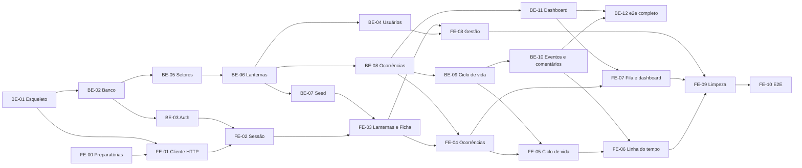

# Plano de trabalho

Versão de 2026-11-06. Backlog das tarefas para entregar o sistema completo, na ordem de [backend/ARQUITETURA.md](backend/ARQUITETURA.md#ordem-de-implementação). Equipe: **dois desenvolvedores** (D24), com o responsável de cada tarefa a atribuir. Cada tarefa vira uma branch e uma PR e usa o formato de [agents/TAREFA.md](agents/TAREFA.md). Regras de código: skills [`backend-api`](../.claude/skills/backend-api/SKILL.md) (BE) e [`frontend-web`](../.claude/skills/frontend-web/SKILL.md) (FE).

Prefixos: **BE** back-end · **FE** front-end · **DOC** documentação.

## Visão geral

## Divisão sugerida entre os dois

Ajuste ao gosto; a ideia é ninguém ficar parado esperando a API.

| Dev | Começa com | Depois |
|---|---|---|
| **Dev 1 (back-end)** | BE-01 a BE-06 | BE-08 a BE-12 |
| **Dev 2 (front e dados)** | FE-00, BE-07 (seed, depende de BE-06), depois assume o FE conforme a API aparece | FE-01 a FE-10 |

Enquanto o Dev 1 faz BE-01 a BE-06, o Dev 2 faz FE-00 e prepara o seed sobre a pesquisa. O redesign OANET (`components/oanet`, `docs/UI.md`) é uma frente à parte: suas telas são integradas ao FE na ordem das tarefas, sem bloquear a lógica.

## Back-end

### BE-01 Esqueleto do back-end
**Depende de:** nada. **Arquivos:** `backend/` (projeto novo), `.env.example`.
Projeto NestJS, ambiente validado na subida (falha sem `JWT_SECRET`), `main.ts` com `ValidationPipe`, Helmet, CORS só do front, filtro global, interceptor de envelope, middleware de log, `@nestjs/throttler`, `GET /saude`.
**Aceite:** `npm run start:dev` sobe; sem variável obrigatória, falha com mensagem; erro de validação e rota inexistente devolvem o envelope; o log não registra `Authorization`; teste e2e do `GET /saude` e de um erro formatado.

### BE-02 Banco e migrations
**Depende de:** BE-01. **Arquivos:** `backend/src/database/`, entidades.
TypeORM + SQLite, `PRAGMA foreign_keys = ON`, `synchronize` desligado, migration inicial das 6 entidades com índices e `CHECK` ([MODELO-DE-DADOS.md](backend/MODELO-DE-DADOS.md)).
**Aceite:** migration sobe do zero e desfaz; inserir valor fora do enum falha no banco; apagar Setor com Lanterna falha na FK.

### BE-03 Autenticação
**Depende de:** BE-02. **Regras:** RN-01, RN-02, RN-06, [DTOS.md](backend/DTOS.md).
`POST /auth/cadastro`, `POST /auth/login` (com `expiresIn`), `GET /auth/me`, guard JWT global, `@Publica()`, `@Papeis()`, bcrypt, limite de login (429).
**Aceite:** os cenários de Acesso e de Login de [CENARIOS-DE-TESTE.md](backend/CENARIOS-DE-TESTE.md); rota nova sem decorator responde 401; o hash nunca aparece em resposta nem log.

### BE-04 Usuários
**Depende de:** BE-06 (o vínculo precisa de Lanternas) e BE-03. **Regras:** RN-03, RN-04, RN-07.
`GET /usuarios`, `PATCH /usuarios/:id/papel`, `PATCH /usuarios/:id/lanterna`.
**Aceite:** cenários RN-03, RN-04 e RN-07.

### BE-05 Setores
**Depende de:** BE-02, BE-03. **Regras:** RN-30, RN-31.
CRUD completo, com leitura pública.
**Aceite:** cenários RN-30 e RN-31; `DELETE` de Setor em uso é 409.

### BE-06 Lanternas e Ficha
**Depende de:** BE-05. **Regras:** RN-22, RN-30, RN-32, RN-33, D13, D25.
`GET /lanternas`, `GET /lanternas/:id` (Ficha com `estatisticas`, `mentor`, `aprendizes`, `fontes`), `POST`, `PATCH`, `PATCH …/status`.
**Aceite:** cenários de Setores e Lanternas (mentor sem ciclo, afastar `em_missao` é 409); a Ficha de um Lanterna só com campos nulos responde 200.

### BE-07 Seed
**Depende de:** BE-06 e BE-08 (para Ocorrências e Eventos). **Referência:** [SEED.md](backend/SEED.md).
Setores, 25 Lanternas, Usuários, Ocorrências com Eventos e Comentários, idempotente.
**Aceite:** a seção "Comando e verificação" do `SEED.md`. A parte de Setores e Lanternas pode ser entregue antes, em duas PRs.

### BE-08 Ocorrências
**Depende de:** BE-06. **Regras:** RN-05, RN-10, RN-16 a RN-18, Prazo (D9).
`GET /ocorrencias` (filtros, busca, ordenação, paginação, `prazoEm`, `vencida`), `minha-fila`, `GET :id`, `POST`, `PATCH`, `DELETE` (soft).
**Aceite:** cenários de Ocorrência (RN-05, RN-10, RN-16 a RN-18) e de Prazo.

### BE-09 Ciclo de vida
**Depende de:** BE-08. **Regras:** RN-11 a RN-15, RN-20 a RN-23, RN-40.
`PATCH …/status` e `PATCH …/responsavel`, transição validada, Lanterna recalculado, Evento gravado, tudo em transação.
**Aceite:** todos os cenários RN-11 a RN-23; a falha injetada no meio deixa o banco intacto; dois pedidos simultâneos não passam juntos.

### BE-10 Eventos e Comentários
**Depende de:** BE-09. **Regras:** RN-40 a RN-43.
`GET …/eventos`, `GET/POST …/comentarios`, `DELETE /comentarios/:id`.
**Aceite:** cenários de Evento e Comentário.

### BE-11 Dashboard
**Depende de:** BE-08. **Regras:** RN-50 a RN-52.
`GET /dashboard` com agregações no banco (`GROUP BY`).
**Aceite:** cenários de Dashboard; nenhuma métrica carrega linhas para agregar em memória.

### BE-12 e2e completo e documentação do back-end
**Depende de:** BE-10, BE-11.
Fechar a suíte com a tabela "Prove" da skill e os cenários que faltarem, `README` do `backend/` e Swagger opcional.
**Aceite:** `npm run test`, `npm run test:e2e` e `npm run build` passam e são relatados.

## Front-end

### FE-00 Preparatórias (não dependem da API)
**Depende de:** nada. **Regras:** PROD-01 a PROD-04, PROD-11 (infra).
Validação de variáveis de ambiente do front, cabeçalhos de segurança e CSP em modo relatório, metadata/robots/sitemap, Playwright instalado e configurado.
**Aceite:** o app não sobe sem `API_URL`; os cabeçalhos aparecem na resposta; `npm run test:e2e` roda um teste de fumaça.

### FE-01 Cliente HTTP único
**Depende de:** FE-00, BE-01. **Regras:** API-02, API-03, API-17, API-18, API-19.
Reescrever `lib/api.ts` e `lib/api-error.ts`; tipo do envelope e da lista paginada.
**Aceite:** testes do cliente com envelope de sucesso, erro com `codigo` e erro sem corpo.

### FE-02 Sessão, login, cadastro e sair
**Depende de:** FE-01, BE-03. **Regras:** AUTH-01 a AUTH-09, AUTH-12 a AUTH-14, [ADR 0001](adr/0001-token-jwt-fica-no-servidor-do-next.md).
`lib/dal.ts`, `proxy.ts`, Actions de login e sair, Route Handler de 401, tela `/cadastro`; remove `lib/sessao.ts` e `lib/usuarios.ts`.
**Aceite:** entrar, sair, cadastrar e ser expulso com token inválido, contra a API real; o token não aparece no JavaScript do navegador.

### FE-03 Setores, Lanternas e Ficha
**Depende de:** FE-02, BE-06, BE-07.
Lista com busca, filtros e paginação; Ficha completa com estatísticas, mentor e selo "não verificado" (D23).
**Aceite:** Ficha de um Lanterna completo e de um quase vazio; paginação pela URL.

### FE-04 Ocorrências: lista, detalhe e nova
**Depende de:** FE-03, BE-08.
Filtros, ordenação, Prazo e "vencida", registrar (sem enviar `setorId` para o Lanterna), 404 para outro Setor.
**Aceite:** cenários de visibilidade por papel e Setor na tela.

### FE-05 Ciclo de vida
**Depende de:** FE-04, BE-09.
Mudar status (com resolução ou motivo), atribuir, editar, excluir; mensagens por `codigo` (422, 409).
**Aceite:** cada erro de regra aparece como mensagem útil; ações por status e papel conforme [frontend/TELAS.md](frontend/TELAS.md).

### FE-06 Linha do tempo e Comentários
**Depende de:** FE-05, BE-10.
**Aceite:** Eventos em ordem, comentar e apagar, estados vazio, erro e carregando.

### FE-07 Minha fila e dashboard
**Depende de:** FE-04, BE-11.
**Aceite:** a fila só para Lanterna; o dashboard muda com o filtro de Setor do Guardião; gráficos com equivalente textual.

### FE-08 Gestão de Setores, Lanternas e Usuários
**Depende de:** FE-03, BE-04.
**Aceite:** só o Guardião acessa; remoção em uso mostra o motivo; o último Guardião não é rebaixado.

### FE-09 Limpeza e testes
**Depende de:** FE-06, FE-07, FE-08. **Referência:** [frontend/MIGRACAO.md](frontend/MIGRACAO.md).
Remover json-server, `db.json`, `scripts/iniciar.sh` (ou reescrevê-lo), marcadores de regras removidas; testes sem `db.json`.
**Aceite:** `npm run test:run`, `npm run lint` e `npm run build` passam; `grep` por `json-server` e `db.json` fora de `docs/` não acha nada.

### FE-10 E2E
**Depende de:** FE-09. **Regras:** PROD-11.
Fluxos principais com Playwright sobre o build e a API real: cadastro, login, registrar, atribuir, resolver, reabrir, comentar.
**Aceite:** a suíte passa em máquina limpa seguindo o [guia](CONTRIBUINDO.md).

## Documentação

### DOC-01 Manter a documentação
**Responsável:** quem documenta, em paralelo. **Quando:** ao fim de cada tarefa.
Atualizar a tabela "Estado do projeto" do `README.md`, a coluna "Estado" de [frontend/TELAS.md](frontend/TELAS.md), `docs/agents/MAPA.md` e o marcador "Destino" para "Atual" nos documentos de [docs/README.md](README.md).
**Aceite:** nenhum documento afirma que existe o que não existe, nem o contrário.

### DOC-02 Entrega
Ao final: `README.md` de execução ponta a ponta, contas de demonstração, e uma revisão de todos os links.

## Marcos

| Marco | Quando as tarefas fecham | Demonstrável |
|---|---|---|
| M1 Login real | BE-01 a BE-03, FE-00 a FE-02 | Cadastro e login contra a API, token fora do navegador |
| M2 Dados de domínio | BE-04 a BE-07, FE-03, FE-08 | Ficha completa dos 25 Lanternas, gestão por Guardião |
| M3 Ocorrências | BE-08, BE-09, FE-04, FE-05 | Registrar, atribuir, resolver e reabrir com as regras |
| M4 Completo | BE-10 a BE-12, FE-06, FE-07, FE-09, FE-10 | Linha do tempo, comentários, fila, dashboard e e2e |
