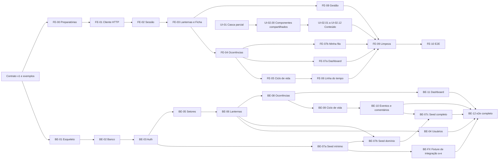

# Plano de trabalho

Atualizado em 2026-11-11. Índice do trabalho para **dois desenvolvedores** (D24): um FE, um BE, com revisão cruzada e coordenação documental. A pausa da [DOC-03](agents/DOC-03-PLANEJAMENTO.md) terminou: o back-end foi implementado (BE-01 a BE-12) e a implementação do front está autorizada desde 2026-11-10. Falta integrar os dois (Corte 1).

Este documento mantém os identificadores e marcos; os passos, arquivos, estados e verificações de cada tarefa estão nos planos de frente. Antes de executar, registre o nome do responsável e a base usando [TAREFA.md](agents/TAREFA.md). Regras: skills [`backend-api`](../.claude/skills/backend-api/SKILL.md) e [`frontend-web`](../.claude/skills/frontend-web/SKILL.md).

## Documentos de execução

| Responsabilidade | Documento ativo | O que permite fazer |
|---|---|---|
| Acordo entre as frentes | [Pacote de contrato v1](contratos/README.md) | Trabalhar contra a mesma entrada/saída, erros e exemplos |
| Dev FE | [Plano completo FE/UI](frontend/PLANO-IMPLEMENTACAO.md) | Migrar OANET e preparar cliente/telas contra contrato sem esperar servidor Nest |
| Dev BE | [Plano completo BE](backend/PLANO-IMPLEMENTACAO.md) | Implementar API e banco com clientes de teste, sem esperar UI |
| Integração e revisão cruzada | [Roteiro de integração](INTEGRACAO.md) | Ativar por recurso depois das provas de consumidor e provedor |
| Pesquisa que orienta os documentos | [Documentação para agentes](research/2026-11-09-documentacao-para-agentes.md) | Entender fontes, contexto sob demanda e limites das verificações |

**Estado real (2026-11-11):** o back-end NestJS **existe** em `backend/` (BE-01 a BE-12, fixture de integração BE-FX e testes do provedor), foi auditado contra o contrato em 2026-11-11 ([relatórios](relatorios/README.md)) e os defeitos achados foram corrigidos. O mock HTTP contratual do front (FE-00) segue planejado. A UI-01 e a UI-02.00 foram integradas à `main` e as telas UI-02.01 a UI-02.12 estão nas branches `front/ui-02-bloco-*`; o front ainda consome o json-server. O laboratório OANET está aprovado. Preparação do front é independente, mas a ativação real acontece em **um primeiro corte integrado único** (cliente, JWT, todos os consumidores existentes e dashboard no lugar do Resumo); histórico, comentários, Minha fila e gestão são aditivos depois dele ([INTEGRACAO](INTEGRACAO.md)).
**Contrato aceito (G-1):** a primeira dependência de FE-00 e BE-01 é o registro G-1 de [INTEGRACAO §2](INTEGRACAO.md#g-1--aceite-do-contrato) (versão e SHA-256 gravados pelo coordenador, sem P0/P1 abertos). “Contrato v1 aceito” nas tarefas abaixo significa G-1.

Prefixos: **UI** adoção visual · **BE** back-end · **FE** front-end · **DOC** documentação. UI-02 é decomposta no plano FE em UI-02.00 (componentes compartilhados) e UI-02.01 a UI-02.12 (rotas); FE-07 divide-se em FE-07a (dashboard) e FE-07b (Minha fila); BE-FX é a fixture de integração do back, só de teste, entregue em etapas a–e. FE-00 a FE-10 e BE-01 a BE-12 mantêm seus IDs.

## Visão geral

O grafo mostra dependências internas de preparação. As arestas entre frentes são gates de **ativação**, especificados em [INTEGRACAO.md](INTEGRACAO.md). A ativação real é um **Corte 1 único**: BE-01, 02, 03, 05, 06, 07a, 07b, 08, 09 e 11 (com BE-FX a–d) ativados junto com FE-01 a FE-05 e FE-07a, sem adaptador legado nem publicação intermediária. FE-06, FE-07b e FE-08 são aditivos depois dele. FE-09/FE-10 só fecham com a API real integrada; testes contra mock não liberam limpeza da demonstração.

## Divisão sugerida entre os dois

Ajuste ao gosto; a ideia é ninguém ficar parado esperando a API.

| Dev | Começa com | Depois |
|---|---|---|
| **Dev 1 (back-end)** | BE-01 a BE-06, BE-07a/b e BE-FX a/b | BE-08 a BE-12 e BE-FX c–e |
| **Dev 2 (front)** | UI-01, UI-02.00 e UI-02.01–12, FE-00/FE-01 e preparação FE contra contrato | FE-02 a FE-08 por recurso, cada um depois da linha UI dos seus arquivos; FE-09/FE-10 após integração |

O Dev 1 também possui BE-07 (seed) e BE-FX (fixture de integração, só de teste); o Dev 2 revisa a conversão da pesquisa sem disputar os arquivos do seed. Enquanto o Dev 1 faz BE-01 a BE-06, o Dev 2 pode fazer UI-01/UI-02 e preparar as tarefas FE contra o contrato. A base OANET já está implementada
e orienta visualmente as tarefas FE. Só um dev front mexe nas páginas: a posse de cada arquivo segue a sequência UI-01 → UI-02.00 → linha UI-02 → tarefa FE ([plano FE](frontend/PLANO-IMPLEMENTACAO.md)). Executar apenas depois que o usuário autorizar o fim da pausa.

**Atualização D28 (2026-11-09):** a direção visual está aprovada e implementada
no laboratório. OANET passa a ser a base obrigatória de todas as tarefas FE;
o contexto histórico de UI-01 está no [handoff](agents/HANDOFF-OANET.md). Depois da
autorização do usuário, a extração visual anda em paralelo ao back-end; a ativação contra
contratos novos acontece no Corte 1, dependente da API.

## Adoção da UI oficial

### UI-01 Casca OANET nas rotas reais — parcial, sem aceite
**Depende de:** base local do laboratório (já existe); não depende da API nova.
**Responsável de implementação:** dev FE a atribuir na retomada; o receptor do handoff preservou o parcial e está na DOC-03, sem retomar código.
**Arquivos:** casca reutilizável em `components/oanet/`, layouts público/privado,
`app/globals.css`, testes correspondentes. Sem dependências novas ou escrita no seed.
Extrair fundo, cabeçalho, navegação, sidebar sticky e ciclo de movimento; usar
rotas/Links e dados da sessão atual, mantendo logout e checagens no servidor.
**Aceite:** casca oficial nas rotas públicas e privadas; navegação por URL,
nome/papel/setor reais, saída funcional, foco/menu acessíveis, movimento reduzido
e modo calmo preservados, sem importar `dados-demo.ts` nos fluxos reais.

### UI-02.00 Componentes compartilhados
**Depende de:** UI-01. Inventário com caminhos reais, testes, destino (adaptar, substituir ou remover) e dono único dos componentes de `components/*.tsx` e `components/ui/*` usados pelas rotas: cabeçalhos, tabela, badges, links, campos, mensagens, estados, marca e navegação. Detalhe e aceite no [plano FE](frontend/PLANO-IMPLEMENTACAO.md#ui-0200--componentes-compartilhados-antes-de-qualquer-rota).
**Aceite:** todo componente do inventário no destino indicado, testes passando, nenhum import de arquivo removido.

### UI-02 Conteúdo e estados no vocabulário OANET
**Depende de:** UI-01 e UI-02.00. Migrar as rotas existentes de [TELAS.md](frontend/TELAS.md)
(portal, Sobre, login, catálogo/ficha, painel, ocorrências e formulários) e
seus estados carregando/erro/vazio/404/acesso negado. Atualizar ou redirecionar
`/design-system`. Reutilizar a arte vetorial e os controles; dados e permissões
continuam reais, mesmo durante a fase json-server.
**Aceite:** nenhuma rota concluída usa o design antigo como referência; sem
mock de login/escrita, com validação, teclado, celular e movimento reduzido
conferidos. Cada entrega atualiza `TELAS.md` com seu estado real.

UI-01/UI-02 não substituem FE-00 a FE-10. FE-02 em diante adotam a casca UI-01;
o marco final M4 exige também UI-02 e a linguagem OANET nas features novas.

## Back-end

### BE-01 Esqueleto do back-end
**Depende de:** G-1 (contrato aceito). **Arquivos:** `backend/` (projeto novo), incluindo `backend/.env.example`; exemplo de ambiente da raiz só muda por atribuição do integrador.
Projeto NestJS, ambiente validado na subida (falha sem `JWT_SECRET`), `main.ts` com `ValidationPipe`, Helmet, CORS só do front, filtro global, interceptor de envelope, middleware de log, `@nestjs/throttler`, `GET /saude`.
**Aceite:** `npm run start:dev` sobe; sem variável obrigatória, falha com mensagem; erro de validação e rota inexistente devolvem o envelope; o log não registra `Authorization`; teste e2e do `GET /saude` e de um erro formatado.

### BE-02 Banco e migrations
**Depende de:** BE-01. **Arquivos:** `backend/src/database/`, entidades.
TypeORM + SQLite, `PRAGMA foreign_keys = ON`, `synchronize` desligado, migration inicial das 6 entidades com índices e `CHECK` ([MODELO-DE-DADOS.md](backend/MODELO-DE-DADOS.md)).
**Aceite:** migration sobe do zero e desfaz; inserir valor fora do enum falha no banco; apagar Setor com Lanterna falha na FK.

### BE-03 Autenticação
**Depende de:** BE-02. **Regras:** RN-01, RN-02, RN-06, [DTOS.md](backend/DTOS.md).
`POST /auth/cadastro`, `POST /auth/login` (com `expiresIn`), `GET /auth/me`, guard JWT global, `@Publica()`, `@Papeis()`, bcrypt, limite de login (429).
**Aceite:** os cenários de Acesso e de Login de [CENARIOS-DE-TESTE.md](backend/CENARIOS-DE-TESTE.md); rota nova sem decorator responde 401; o hash nunca aparece em resposta nem log.

### BE-04 Usuários
**Depende de:** BE-06 (o vínculo precisa de Lanternas) e BE-03. **Regras:** RN-03, RN-04, RN-07/08.
`GET /usuarios`, `PATCH /usuarios/:id/papel`, `PATCH /usuarios/:id/lanterna`.
**Aceite:** cenários RN-03, RN-04, RN-07/08, incluindo rebaixamento sem Setor e concorrência do último Guardião.

### BE-05 Setores
**Depende de:** BE-02, BE-03. **Regras:** RN-30, RN-31.
CRUD completo, com leitura pública. A leitura pública é pré-condição de G2: o cadastro do front carrega os Setores por ela.
**Aceite:** cenários RN-30 e RN-31; `DELETE` de Setor em uso é 409.

### BE-06 Lanternas e Ficha
**Depende de:** BE-05. **Regras:** RN-22, RN-30, RN-32/33/34, D13, D25.
`GET /lanternas`, `GET /lanternas/:id` (Ficha com `estatisticas`, `mentor`, `aprendizes`, `fontes`), `POST`, `PATCH`, `PATCH …/status`.
**Aceite:** cenários de Setores e Lanternas (mentor sem ciclo, afastar `em_missao` é 409); a Ficha de um Lanterna só com campos nulos responde 200.

### BE-07 Seed por etapas
**Dependências:** BE-07a após BE-03 (mínimo para login); BE-07b após BE-06/07a (Setores, 25 Fichas e vínculos); BE-07c após BE-09/10/07b (Ocorrências, Eventos e Comentários). **Referência:** [SEED.md](backend/SEED.md) e [plano BE](backend/PLANO-IMPLEMENTACAO.md).
Cada etapa é idempotente e usa banco próprio. O seed demonstrativo não substitui a fixture de integração (BE-FX). A etapa final confere 7 Setores conforme D25, sem inventar um oitavo.
**Aceite:** a seção "Comando e verificação" do `SEED.md`, com evidência separada por etapa.

### BE-08 Ocorrências
**Depende de:** BE-06 e BE-03. **Regras:** RN-05, RN-10, RN-16 a RN-19, RN-40 desde a primeira mutação, Prazo (D9).
`GET /ocorrencias` (filtros, busca, ordenação, paginação, `prazoEm`, `vencida`), `minha-fila`, `GET :id`, `POST`, `PATCH`, `DELETE` (soft).
**Aceite:** cenários de Ocorrência (RN-05, RN-10, RN-16 a RN-18) e de Prazo.

### BE-09 Ciclo de vida
**Depende de:** BE-08. **Regras:** RN-11 a RN-15, RN-20 a RN-23, RN-40.
`PATCH …/status` e `PATCH …/responsavel`, transição validada, Lanterna recalculado, Evento gravado (inclusive `atribuida` ao atribuir, reatribuir e liberar), tudo em transação. Liberar uma Ocorrência em andamento é 422 `SEM_RESPONSAVEL` sem mutação.
**Aceite:** todos os cenários RN-11 a RN-23; a falha injetada no meio, inclusive na gravação do Evento `atribuida`, deixa o banco intacto. Corridas preservam as invariantes e têm resultado serializável: atribuir versus afastar admite somente as linearizações definidas no plano BE; atribuições válidas não são proibidas por um limite artificial de carga.

### BE-10 Eventos e Comentários
**Depende de:** BE-09. **Regras:** RN-40 a RN-43.
`GET …/eventos`, `GET/POST …/comentarios`, `DELETE /comentarios/:id`.
**Aceite:** cenários de Evento e Comentário.

### BE-11 Dashboard
**Depende de:** BE-08. **Regras:** RN-50 a RN-52.
`GET /dashboard` com agregações no banco (`GROUP BY`).
**Aceite:** cenários de Dashboard; nenhuma métrica carrega linhas para agregar em memória.

### BE-FX Fixture de integração (somente de teste)
**Dono:** dev BE. **Entrega incremental:** etapa a com BE-07a, b com BE-07b, c com BE-08, d com BE-09, e com BE-10, cada uma antes dos gates que a usam. Comando planejado `npm run fixture:integracao`, arquivos próprios em `backend/src/testing/fixture-integracao/`, ids estáveis e manifesto de estado; sem endpoint de bootstrap. Datas relativas ao instante da fixture, com margem; casos exatos de Prazo no teste do provedor com relógio injetável. Detalhe no [plano BE](backend/PLANO-IMPLEMENTACAO.md#be-fx--fixture-de-integração-somente-de-teste) e em [INTEGRACAO §4](INTEGRACAO.md#4-fixtures-identidade-e-testes-de-escrita).
**Aceite:** banco novo migrado recebe as contas, vínculos e Ocorrências do cenário; manifesto sem segredo; recusa produção e banco com dados.

### BE-12 e2e completo e documentação do back-end
**Depende de:** BE-04, BE-07c, BE-10, BE-11 e BE-FX completo.
Fechar a suíte com a tabela "Prove" da skill e os cenários que faltarem, `README` do `backend/` e Swagger opcional.
**Aceite:** `npm run test`, `npm run test:e2e` e `npm run build` passam e são relatados.

## Front-end

### FE-00 Preparatórias (não dependem da API)
**Depende de:** G-1 (contrato aceito) para o fake HTTP; infraestrutura pode começar sem API. **Regras:** PROD-01 a PROD-04, PROD-11 (infra).
Validação de variáveis de ambiente do front, cabeçalhos de segurança e CSP em modo relatório, metadata/robots/sitemap, Playwright (inclusive o download planejado do Chromium) e servidor HTTP contratual de desenvolvimento/teste. Dependências e configurações novas têm escopo explícito nesta tarefa, detalhado no plano FE, com o dev front como dono único de `package.json` e do lock.
**Aceite:** o app não sobe sem `API_URL`; os cabeçalhos aparecem na resposta; `npm run test:e2e` roda um teste de fumaça.

### FE-01 Cliente HTTP único
**Preparação depende de:** FE-00 e G-1. **Ativação (Corte 1):** gate HTTP com BE-01, junto com os consumidores; nunca sozinho. **Regras:** API-02, API-03, API-17, API-18, API-19.
Reescrever `lib/api.ts` e `lib/api-error.ts`; tipo do envelope e da lista paginada.
**Aceite:** testes do cliente com envelope de sucesso, erro com `codigo` e erro sem corpo.

### FE-02 Sessão, login, cadastro e sair
**Preparação depende de:** FE-01 e UI-02.03. **Ativação (Corte 1):** BE-03 e BE-05 (leitura de Setores para o cadastro) aceitos, gate de sessão. **Regras:** AUTH-01 a AUTH-09, AUTH-12 a AUTH-14, [ADR 0001](adr/0001-token-jwt-fica-no-servidor-do-next.md).
`lib/dal.ts`, `proxy.ts`, Actions de login e sair, Route Handler de 401, tela `/cadastro`; remove `lib/sessao.ts` e `lib/usuarios.ts`.
**Aceite:** entrar, sair, cadastrar e ser expulso com token inválido, contra a API real; o token não aparece no JavaScript do navegador.

### FE-03 Setores, Lanternas e Ficha
**Preparação depende de:** FE-02 e exemplos de catálogo/Ficha. **Ativação:** BE-06 e seed do recurso aceitos.
Lista com busca, filtros e paginação; Ficha completa com estatísticas, mentor e selo "não verificado" (D23).
**Aceite:** Ficha de um Lanterna completo e de um quase vazio; paginação pela URL.

### FE-04 Ocorrências: lista, detalhe e nova
**Preparação depende de:** FE-03 e exemplos de ocorrências. **Ativação:** BE-08 aceito.
Filtros, ordenação, Prazo e "vencida", registrar (sem enviar `setorId` para o Lanterna), 404 para outro Setor.
**Aceite:** cenários de visibilidade por papel e Setor na tela.

### FE-05 Ciclo de vida
**Preparação depende de:** FE-04 e exemplos de transições. **Ativação:** BE-09 aceito.
Mudar status (com resolução ou motivo), atribuir, editar, excluir; mensagens por `codigo` (422, 409).
**Aceite:** cada erro de regra aparece como mensagem útil; ações por status e papel conforme [frontend/TELAS.md](frontend/TELAS.md).

### FE-06 Linha do tempo e Comentários
**Preparação depende de:** FE-05 e exemplos de eventos/comentários. **Ativação:** BE-10 aceito.
**Aceite:** Eventos em ordem, comentar e apagar, estados vazio, erro e carregando.

### FE-07a Dashboard (substitui o Resumo)
**Preparação depende de:** FE-04, UI-02.06 e exemplos de dashboard. **Ativação (Corte 1):** BE-11 aceito.
**Aceite:** o dashboard muda com o filtro de Setor do Guardião; gráficos com equivalente textual; nenhuma contagem vem só da primeira página da lista.

### FE-07b Minha fila
**Preparação depende de:** FE-04 e exemplos de fila. **Ativação (aditiva, depois do Corte 1):** BE-08/BE-09 aceitos.
**Aceite:** a fila só para Lanterna; links por papel corretos na casca.

### FE-08 Gestão de Setores, Lanternas e Usuários
**Preparação depende de:** FE-03 e exemplos de gestão. **Ativação:** BE-04/BE-05/BE-06 aceitos por recurso.
**Aceite:** só o Guardião acessa; remoção em uso mostra o motivo; o último Guardião não é rebaixado.

### FE-09 Limpeza e testes
**Depende de:** FE-06, FE-07a, FE-07b, FE-08 e UI-02 inteira. **Referência:** [frontend/MIGRACAO.md](frontend/MIGRACAO.md).
Remover json-server, `db.json`, `scripts/iniciar.sh` (ou reescrevê-lo), marcadores de regras removidas; testes sem `db.json`.
**Aceite:** `npm run test:run`, `npm run lint` e `npm run build` passam; o [procedimento canônico de remoção](frontend/PLANO-IMPLEMENTACAO.md#procedimento-canônico-de-remoção) (escopo explícito, equivalente em PowerShell, `npm ls json-server --all`) sai vazio. Menções históricas em `docs/` e nas skills não contam como dependência.

### FE-10 E2E
**Depende de:** FE-09. **Regras:** PROD-11.
Fluxos principais com Playwright sobre o build e a API real: cadastro, login, registrar, atribuir, resolver, reabrir, comentar.
**Aceite:** a suíte passa em máquina limpa seguindo o [guia](CONTRIBUINDO.md).

## Documentação

### DOC-01 Manter a documentação
**Responsável:** quem documenta, em paralelo. **Quando:** ao fim de cada tarefa.
Atualizar a tabela "Estado do projeto" do `README.md`, a coluna "Estado" de [frontend/TELAS.md](frontend/TELAS.md), `docs/agents/MAPA.md` e o marcador "Destino" para "Atual" nos documentos de [docs/README.md](README.md).
**Aceite:** nenhum documento afirma que existe o que não existe, nem o contrário.

### DOC-02 Entrega
Ao final: `README.md` de execução ponta a ponta, contas de demonstração, e uma revisão de todos os links.

### DOC-03 Planos separados, contrato e revisão por agentes
**Estado:** concluída, somente documentação. **Responsável:** Codex coordenador, com pesquisa, autores delimitados e duas revisões/duas correções Claude Code/Sonnet 5.5 concluídas. Aceite técnico documental e hash em [G-1](INTEGRACAO.md#g-1--aceite-do-contrato).
Consolidar contrato v1 com formatos/exemplos completos, planos FE/UI e BE independentes, roteiro de integração e índice de todas as pastas. Aplicar pesquisa primária sobre documentação para agentes, procurar falhas com revisores independentes e delegar correções antes da entrega.
**Aceite:** links/pastas e pacote contratual verificados, achados classificados e corrigidos ou explicitamente pendentes, sem tratar mocks ou planos como implementação pronta. Registro e comandos em [DOC-03-PLANEJAMENTO.md](agents/DOC-03-PLANEJAMENTO.md). A conclusão desta tarefa não retoma a implementação automaticamente.

## Marcos

| Marco | Quando as tarefas fecham | Demonstrável |
|---|---|---|
| M1 Autenticação isolada | BE-01 a BE-03, BE-05 (leitura), BE-07a e BE-FX a como provedor aceito (B); FE-00 a FE-02 como consumidor preparado (P) | Cadastro e login demonstrados no provedor com clientes de teste e no consumidor contra o fake, token fora do navegador. **Não** é publicação parcial do app real |
| M2 Domínio isolado | BE-04 a BE-07b e BE-FX b (B); FE-03 e FE-08 (P) | Ficha completa dos 25 Lanternas no provedor e telas preparadas; gestão por Guardião ainda sem ativação |
| M3 Corte 1 integrado (A) | BE-01 a BE-03, BE-05, BE-06, BE-07a/b, BE-08, BE-09, BE-11, BE-FX a–d; FE-01 a FE-05, FE-07a, UI-01, UI-02.00 e UI-02.03–10 | App real com login, cadastro, catálogo e Ficha, dashboard no lugar do Resumo, registrar, atribuir, resolver e reabrir, tudo contra API e SQLite reais, com o roteiro visual |
| M4 Completo | UI-01/UI-02 inteira, BE-04, BE-07c, BE-10 a BE-12, FE-06, FE-07b, FE-08 (aditivos), FE-09, FE-10 | Linguagem OANET em todas as rotas, linha do tempo, comentários, fila, gestão, remoção da demonstração e e2e |
