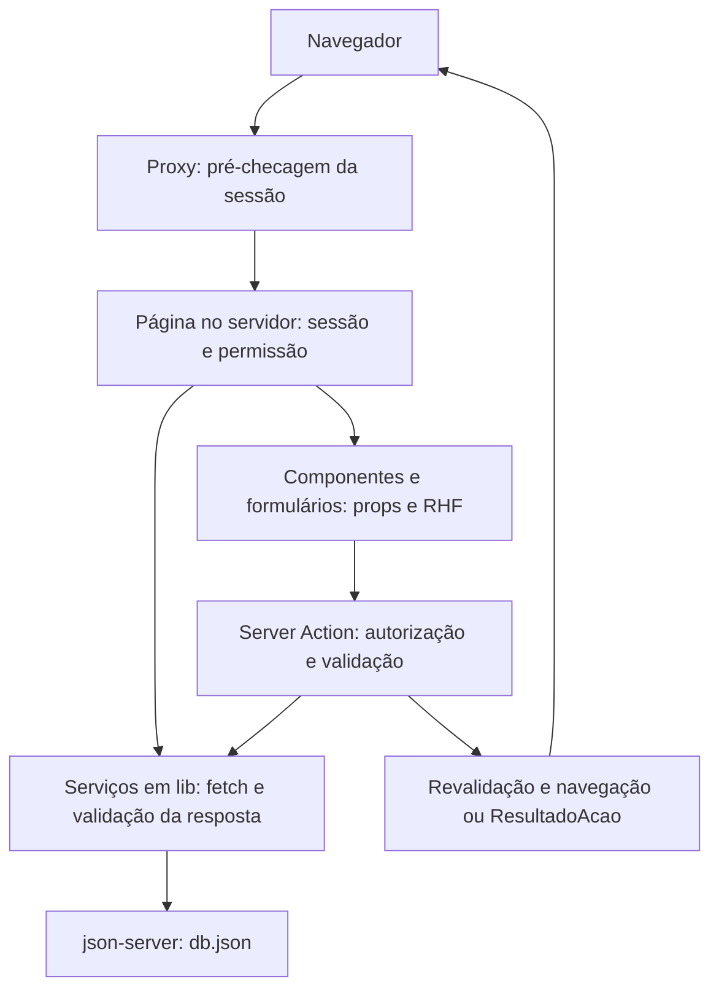

# Mapa da codebase

Levantamento conferido em 2026-11-06, a partir de `f819c48` e do estado local.
Planejamento documental atualizado em 2026-11-09; a UI-01 foi concluída e integrada à `main` pela PR #1 em 2026-11-10 (merge `f0cb363`). A pausa de planejamento registrada em [DOC-03](DOC-03-PLANEJAMENTO.md) deixou de valer para o front em 2026-11-10.
Use este mapa para encontrar os arquivos; confirme contratos no código antes
de alterá-los. As regras de código estão nas skills
[`frontend-web`](../../.claude/skills/frontend-web/SKILL.md) e
[`backend-api`](../../.claude/skills/backend-api/SKILL.md).

> **Em migração.** Este mapa descreve o **código de hoje**: front-end Next.js
> consumindo o json-server. O back-end NestJS já está implementado em `backend/`
> (ver a seção abaixo); a ligação do front a ele (JWT em cookie `httpOnly`,
> features novas) é o Corte 1 e está em [docs/README.md](../README.md), e o caminho entre os dois
> em [frontend/MIGRACAO.md](../frontend/MIGRACAO.md). A seção "Leitura, cache e
> erros" será reescrita quando a migração chegar ao passo correspondente.

## Arquitetura atual

Aplicação Next.js com App Router, TypeScript e React. O json-server continua como
API de demonstração do front. `backend/` agora contém bootstrap HTTP, persistência
SQLite/TypeORM, autenticação, seeds mínimo/completo, rotas de Usuários, Setores,
Lanternas, Ocorrências, linha do tempo de Eventos e Comentários e Dashboard
(BE-01/02/03/04/05/06/07a/07b/08/09/10/07c/11). A entrega de contrato completa
segue no [plano BE](../backend/PLANO-IMPLEMENTACAO.md).
Consulte versões e scripts em [package.json](../../package.json), sem pressupor
as APIs de outra versão do framework.

O proxy só cobre as rotas configuradas em [proxy.ts](../../proxy.ts).
Leituras públicas não exigem sessão; cada página privada faz a própria checagem.
O diagrama representa fluxos de aplicação, não uma barreira de autenticação
oferecida pelo json-server.

## Onde trabalhar

| Pedido | Ponto de entrada | Dependências a consultar |
|---|---|---|
| Home, Sobre e navegação pública | `app/(site)/page.tsx`, `sobre/`, layout público | `components/oanet/CascaOa.tsx` (substitui `MenuNavegacao` e `Marca`, removidos na UI-02.00), `Juramento` |
| Lista e detalhe de lanternas | `app/(site)/lanternas/` | `lib/lanternas.ts`, `lib/setores.ts`, `lib/schemas/lanterna.ts`, `lib/schemas/setor.ts`, `components/Paginacao.tsx` |
| Login | `app/(site)/login/` | `lib/auth.ts`, `lib/schemas/login.ts`, `lib/schemas/senha.ts`, DAL e sessão |
| Cadastro | `app/(site)/cadastro/` | `lib/cadastro.ts`, `lib/schemas/cadastro.ts`, `lib/schemas/senha.ts`, DAL e sessão |
| Logout | `app/(painel)/actions.ts` e layout privado | `lib/dal.ts` |
| Resumo | `app/(painel)/painel/page.tsx` | Serviços de ocorrências, setores, lanternas e `setorParaFiltro` |
| Listagem e filtros privados | `app/(painel)/painel/ocorrencias/page.tsx`, `_components/FiltroOcorrencias.tsx` | `lib/filtro-ocorrencias.ts`, schema e serviço de ocorrências |
| Criar, alterar status ou atribuir | `app/(painel)/painel/ocorrencias/actions.ts` | Formulário correspondente, schemas, DAL e serviços |
| Detalhe e atribuição | `app/(painel)/painel/ocorrencias/[id]/` | `tratarErroDetalhe`, autorização e formulários |
| UI oficial e assets | `components/oanet/`, `app/globals.css`, `app/laboratorio/` | `docs/UI.md` (D28), `docs/agents/HANDOFF-OANET.md`; `/design-system` antigo é histórico |
| Dados de demonstração | `db.json` | Schemas e testes que importam os dados (saem na migração) |
| Adoção nas rotas reais | Layouts `(site)`/`(painel)`, páginas e componentes OANET | UI-01/UI-02 em `docs/PLANO.md`; propriedade transferida pelo handoff, conferir alterações locais |
| Regras, rotas e dados da API | `docs/backend/` (`ESCOPO`, `REGRAS-DE-NEGOCIO`, `API`, `MODELO-DE-DADOS`, `ARQUITETURA`) | Skill `backend-api`; o código está em `backend/` (NestJS) |
| Telas atuais e planejadas | `docs/frontend/TELAS.md` | `docs/frontend/ARQUITETURA.md` |
| Trabalho independente FE/BE | `docs/frontend/PLANO-IMPLEMENTACAO.md`, `docs/backend/PLANO-IMPLEMENTACAO.md` | `docs/PLANO.md`, `docs/INTEGRACAO.md` |
| Contrato verificável e exemplos | `docs/contratos/` | `docs/backend/API.md`, `DTOS.md`; a API real existe em `backend/`; o mock HTTP do front (FE-00) ainda não |
| Componentes compartilhados (cabeçalho, tabela, badges, campos, estados) | `components/*.tsx`, `components/ui/*` | Inventário e destino em UI-02.00 do plano FE; consumidores em `app/` |
| Ordem de ativação real (Corte 1 e aditivos) e fixture de integração | `docs/INTEGRACAO.md` §3 e §4 | Planos FE/BE; BE-01/02/03/04/05/06/07a/07b/08/09/10 e fixture etapas a–e existem |

`(site)` e `(painel)` organizam layouts sem aparecer na URL. `_components`
contém componentes locais da rota. `components/` concentra os compartilhados.
O alias `@/` aponta para a raiz, conforme [tsconfig.json](../../tsconfig.json).

## Fronteiras e contratos

| Fronteira | Contrato e fonte |
|---|---|
| Navegador → action | RHF chama action com dados; a action recebe `unknown`, valida e usa `parsed.data`. Exemplo: [FormOcorrencia](../../app/(painel)/painel/ocorrencias/_components/FormOcorrencia.tsx) e [actions](../../app/(painel)/painel/ocorrencias/actions.ts) |
| Action → formulário | [ResultadoAcao](../../lib/resultado-acao.ts): `ok`, `erro` geral e `errors` por campo; [aplicarErrosDoServidor](../../lib/erros-formulario.ts) aplica os erros no RHF |
| Página/action → autorização | [DAL](../../lib/dal.ts): `verificarSessao`, `exigirPapel`, criação/leitura/remoção de cookie |
| Sessão → setor | [escopo.ts](../../lib/escopo.ts): `podeAcessarSetor`, `setorParaFiltro`; o setor vem do `Usuario` devolvido por `/auth/me` |
| Servidor → HTTP | [api.ts](../../lib/api.ts) tem o cliente único `requisitarApi` e `requisitarApiSemConteudo`: valida o envelope `{ sucesso, dados }` com o schema do serviço, exige cache explícito e envia Bearer quando há token; `urlDaApi` fica só para os serviços json-server ainda não migrados |
| HTTP → erro de detalhe | [ApiError](../../lib/api-error.ts) carrega status, código e detalhes; [tratarErroDetalhe](../../lib/erro-detalhe.ts) navega em 401/403, chama `notFound` em 404 e converte 400 de leitura de detalhe em `notFound` |
| HTTP → erro de Action | [resultadoDeErroApi](../../lib/api-error.ts) e [destinoDoErro](../../lib/api-error.ts) tratam `ApiError` em Actions |
| Persistência → tela | Actions de escrita revalidam `/painel` no escopo `layout`; cadastro/atribuição redirecionam e status retorna `{ ok: true }` |

Os serviços de `lib/` não recebem sessão. Quem chama `listarOcorrencias` precisa
aplicar o filtro autorizado; quem busca um detalhe privado precisa conferir seu
setor. Reutilizar um serviço não aplica automaticamente essas permissões.

## Domínio e permissão

As regras abaixo são as **atuais**. As do destino (máquina de estados, Prazo,
Lanterna afastado, 404 em vez de acesso negado para outro Setor) estão em
[REGRAS-DE-NEGOCIO.md](../backend/REGRAS-DE-NEGOCIO.md) e a matriz completa em
[API.md](../backend/API.md#matriz-de-permissões).

As coleções atuais são setores, lanternas, usuários e ocorrências. Os schemas
em [lib/schemas](../../lib/schemas) definem campos, tipos e enums. Vários IDs são
normalizados para string; preserve os contratos nas relações entre coleções.

| Operação | Guardião | Lanterna |
|---|---|---|
| Consultar ocorrências | Todos os setores, com filtro opcional | Somente o setor da sessão |
| Abrir detalhe e mudar status | Qualquer setor | Somente o próprio setor |
| Registrar ocorrência | Escolhe um setor existente | Servidor fixa o setor da sessão |
| Atribuir responsável | Responsável deve pertencer ao setor da ocorrência | Bloqueado por papel |

Fontes: [escopo.ts](../../lib/escopo.ts),
[actions de ocorrências](../../app/(painel)/painel/ocorrencias/actions.ts), páginas
privadas e DEC-03/AUTH-07 da skill. O acesso negado é apresentado pela navegação
para `/acesso-negado`; isso não equivale a devolver um status HTTP 403 da API.

Ao cadastrar, o servidor define `status: 'aberta'`, responsável/resolução nulos,
criador a partir da sessão e data atual. O
[schema de status](../../lib/schemas/ocorrencia.ts) exige explicação de pelo menos
dez caracteres para resolver; a action limpa resolução nos outros status.

## Sessão e dados privados

> Estado **preparado contra contrato** (FE-02, modo P), na branch
> `front/fe-02-sessao`, sem ativação real. O contrato é o v1.0.0 da API; a
> decisão de manter o JWT no servidor do Next está na
> [ADR 0001](../adr/0001-token-jwt-fica-no-servidor-do-next.md).

O login chama `POST /auth/login` e grava o JWT devolvido só no cookie `sessao`:
`httpOnly`, `sameSite: 'lax'`, path `/`, `secure` em produção e validade igual a
`expiresIn`. O cookie não guarda dados do usuário; [cookie.ts](../../lib/cookie.ts)
define só o nome do cookie, compartilhado com o proxy.

[auth.ts](../../lib/auth.ts) (`server-only`) concentra `entrarNaApi`,
`buscarUsuarioAtual` (GET `/auth/me` com Bearer), `gravarCookieSessao`,
`apagarCookieSessao` e `lerToken`.

[dal.ts](../../lib/dal.ts) é a fronteira de autorização:

- `lerSessao` devolve o `Usuario` do contrato, ou `null` sem token ou com 401;
- `verificarSessao` vai para `/login` sem token e para
  [sessao-expirada](../../app/sessao-expirada/route.ts) com 401;
- `exigirPapel` vai para `/acesso-negado` quando o papel não basta;
- `lerTokenObrigatorio` devolve o token para chamadas à API.

Papel e setor não ficam no cookie: vêm de `/auth/me` a cada requisição. Uma
promoção ou um rebaixamento na API vale na próxima requisição. `setorId` é
inteiro ou `null`.

[app/sessao-expirada/route.ts](../../app/sessao-expirada/route.ts) apaga o cookie
e redireciona para `/login?expirou=1`. Sem cookie, o proxy não manda de volta
ao painel, então não há laço entre `/login` e `/painel`.

[proxy.ts](../../proxy.ts) só verifica a presença do cookie: `/painel` sem cookie
vai para `/login`, e `/login` ou `/cadastro` com cookie vão para `/painel`. A
validade do token é decidida pela API, na DAL.

[escopo.ts](../../lib/escopo.ts) concentra `podeAcessarSetor` e `setorParaFiltro`.
Lanterna sem setor recebe `-1`, que não casa com nenhum setor. As páginas do
painel ainda usam serviços do json-server, que comparam setores convertendo com
`Number` e `String`; essa conversão sai na migração (FE-04).

`lib/sessao.ts` (HMAC) e `lib/usuarios.ts` (busca de usuário com senha) foram
removidos. O código desta branch não lê mais `SESSION_SECRET`; a remoção de
`.env.example` fica para FE-09.

O json-server mantém usuários e senhas de demonstração em texto puro e não
autentica suas próprias rotas. Isso está declarado no [README](../../README.md)
e em AUTH-11; a migração do back-end depende de autenticação real na API.

## Leitura, cache e erros

- [Lanternas](../../lib/lanternas.ts) e [setores](../../lib/setores.ts):
  revalidação de 60 segundos nas leituras.
- [Ocorrências](../../lib/ocorrencias.ts): leituras sem cache; ocorrência usa
  POST para criar e PATCH para alterar.
- Filtros privados usam [normalizarFiltroOcorrencias](../../lib/filtro-ocorrencias.ts)
  tanto no servidor quanto nos controles para manter a interpretação consistente.
- Componentes como `EstadoVazio`, `EsqueletoLista` e `TelaDeErro`, além dos
  `loading.tsx`, `error.tsx` e `not-found.tsx`, representam os estados das rotas.
- Os serviços usam filtros e ordenação próprios do json-server 0.17.4. Uma nova
  API precisa preservar esse contrato ou ser adaptada nos serviços/schemas.

## Interface e referências

Os formulários usam React Hook Form e Zod 4. `CampoTexto` usa registro do RHF;
`CampoSelect` integra o select controlado via `Controller`. O visual compartilhado
usa Base UI sob os componentes shadcn já personalizados. Preserve exports e props
quando a alteração for apenas visual.

Tokens estão em [globals.css](../../app/globals.css); fontes no
[layout raiz](../../app/layout.tsx). O escopo `.oa-lab` e as três folhas
`movimento-*.css` compõem a UI oficial OANET (D28); sua extração para as rotas
reais segue [UI.md](../UI.md) e o [handoff](HANDOFF-OANET.md).
A vitrine `/design-system` antiga é histórica. STACK-02/03, DEC-05/11/12/13 e
as regras de formulário/semântica continuam aplicáveis.

## Testes e documentação existentes

`__tests__/lib/` cobre schemas, serviços e helpers; `__tests__/acoes/` cobre
actions com dependências simuladas; há testes de proxy, componentes e páginas
síncronas. Consulte o [guia de trabalho](README.md#verificar-e-entregar) para executar
as verificações. A pesquisa registra cobertura observada e lacunas sem pressupor
cobertura completa ou resultado aprovado.

| Documento | Uso |
|---|---|
| [Escopo e decisões](../backend/ESCOPO.md) | Enunciado e decisões vigentes; números antigos não limitam as decisões aplicáveis |
| [Índice da documentação](../README.md) | Todos os documentos e se descrevem o estado atual ou o destino |
| [Spec visual antiga](../superpowers/specs/2026-10-07-design-system-tropa-design.md) | Histórico; não orienta o design novo |
| [UI.md](../UI.md) | UI oficial OANET, assets e movimento aprovados (D28) |
| [Handoff OANET](HANDOFF-OANET.md) | Histórico da transferência da UI-01 e evidências; a sequência vigente está no plano FE |

Em divergência entre documentação e implementação, registre a diferença e
confira a decisão em `ESCOPO.md` antes de mudar ambos.
