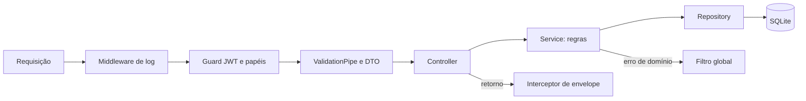

# Arquitetura do back-end

Versão de 2026-11-06, decisões fechadas. Regras em [REGRAS-DE-NEGOCIO.md](REGRAS-DE-NEGOCIO.md), contrato em [API.md](API.md), dados em [MODELO-DE-DADOS.md](MODELO-DE-DADOS.md). O ponto de partida de código é `.claude/skills/backend-api/assets/nestjs-referencia/`.

## Stack

NestJS, TypeORM e SQLite (enunciado). Validação com `class-validator` e `class-transformer`; senha com `bcrypt`; token com `@nestjs/jwt`; limite de login com `@nestjs/throttler`; cabeçalhos com `helmet`. Testes com Jest e `supertest`. Versões conferidas no `package.json` ao criar o projeto.

## Camadas

O controller traduz HTTP, o service decide, o repository guarda.

Execução independente do front: [plano BE](PLANO-IMPLEMENTACAO.md). O provedor deve atender ao [contrato v1](../contratos/README.md); a integração das duas frentes segue [INTEGRACAO.md](../INTEGRACAO.md). O documento OpenAPI gerado pelo Nest é comparado ao contrato acordado, sem substituí-lo automaticamente.



- O controller só lê parâmetros, chama o service e devolve dados.
- O service não conhece `Request` nem `Response`; lança exceções de domínio com `codigo` estável.
- O repository devolve nulo quando não acha; o service decide o 404.
- Uma regra que cruza assuntos (atribuir mexe em Ocorrência, Lanterna e Evento) fica no service dono do assunto principal e pede aos outros pelos services deles; a transação é aberta nesse service.

## Pastas

Por assunto, com o módulo junto, não por tipo de arquivo.

```
backend/
  package.json
  .env.example
  src/
    main.ts                    validação de ambiente, pipes, helmet, CORS, prefixo
    app.module.ts
    comum/                     filtro global, interceptor de envelope, middleware de log,
                               exceção de domínio, paginação, decorators de papel e usuário
    config/                    leitura e validação do ambiente
    auth/                      cadastro, login, /auth/me, guard JWT global, guard de papéis
    usuarios/                  listagem, promoção de papel
    setores/
    lanternas/                 Ficha, estatísticas, status
    ocorrencias/               ciclo de vida, atribuição, fila, prazo
    eventos/                   gravação e consulta da linha do tempo
    comentarios/
    dashboard/                 consultas agregadas
    database/
      migrations/              esquema versionado
      seed/                    dados de exemplo e comando de execução
  test/                        e2e
```

Cada módulo de assunto tem `entity`, `repository`, `service`, `controller` e `dto/`.

## Decisões de estrutura

| Tema | Decisão |
|---|---|
| Guard global | Toda rota nasce protegida; as públicas levam um decorator `@Publica()`. |
| Papéis | Decorator `@Papeis('guardiao')` e guard próprio; o guard JWT recarrega o usuário (RN-06). |
| Transações | O service abre a transação e passa o `EntityManager` aos repositories; Evento é gravado na mesma. |
| Esquema | Migrations versionadas; sincronização automática desligada, inclusive em desenvolvimento. (D22) |
| Chaves estrangeiras | `PRAGMA foreign_keys = ON` na conexão. |
| Prazo e vencida | Calculados no service a partir de `criadaEm` e da Gravidade; nada agendado. |
| Dashboard | `GROUP BY` no banco, sem carregar linhas e agregar em memória. |
| Concorrência | Atribuição e mudança de Status usam `UPDATE … WHERE` condicional e conferem linhas afetadas. SQLite serializa escritas, mas a regra continua no SQL. |
| Datas | UTC em ISO 8601; o front formata. |

## Ambiente

Variáveis, todas validadas na subida (a API não inicia sem elas): `PORT`, `DATABASE_PATH`, `JWT_SECRET` (sem valor padrão), `JWT_EXPIRES_IN` (`8h`), `CORS_ORIGIN` (origem do front), `LOGIN_LIMITE` e `LOGIN_JANELA_SEGUNDOS`. `.env` fica fora do Git, com `.env.example` versionado.

## Seed

- Comando `npm run seed` no `backend`, idempotente: reexecutar não duplica dados.
- Fonte dos Lanternas: os arquivos de `docs/research/lanternas/` (D18), convertidos em uma lista tipada no código do seed, com o campo `fontes`.
- As senhas de demonstração entram hasheadas; o README lista as contas.
- As Ocorrências atuais do `db.json` ganham Eventos coerentes com seu estado.

## Testes

| Nível | O que cobre |
|---|---|
| Unitário (Jest) | Services com repositories falsos: transições (RN-11 a RN-16), efeitos em Lanterna (RN-20 a RN-23), Prazo, permissões por Setor |
| e2e (`supertest`, SQLite em memória) | Cada linha da tabela "Prove" da skill: 200/201/204, 400 com campo extra, 401, 403, 404, 409, 422, 429, falha no meio de várias escritas e duas atribuições simultâneas |

O e2e usa o mesmo `ValidationPipe`, filtro e interceptor do `main.ts`, para testar o envelope real.

## Ordem de implementação

1. Projeto `backend/`, config, envelope, filtro, log, auth (cadastro, login, `/auth/me`) e seed mínimo. Entrega: login funcionando e testado.
2. Setores, Lanternas e Ficha, com seed completo.
3. Ocorrências: ciclo de vida, atribuição, Eventos e Prazo.
4. Comentários e Dashboard.
5. Ativação da migração do front por recurso aceito: `lib/*`, Actions, `dal.ts`, `proxy.ts`. Preparação de cliente e telas contra contrato pode ocorrer em paralelo antes, conforme D29.
6. Aceite integrado das telas; remover json-server e `db.json` apenas no gate de limpeza, depois de todas as dependências reais verificadas.

Cada passo termina com verificações e resultados relatados; a ativação do front depende da API correspondente e acontece em um corte integrado único (BE-01 a BE-03, BE-05, BE-06, BE-07a/b, BE-08, BE-09 e BE-11), com a fixture de integração só de teste (BE-FX) entregue por etapas junto desses passos. A ordem técnica detalhada em `PLANO-IMPLEMENTACAO.md` inclui o Setor mínimo necessário ao cadastro e os Eventos gravados desde a primeira mutação, evitando dependências circulares.
