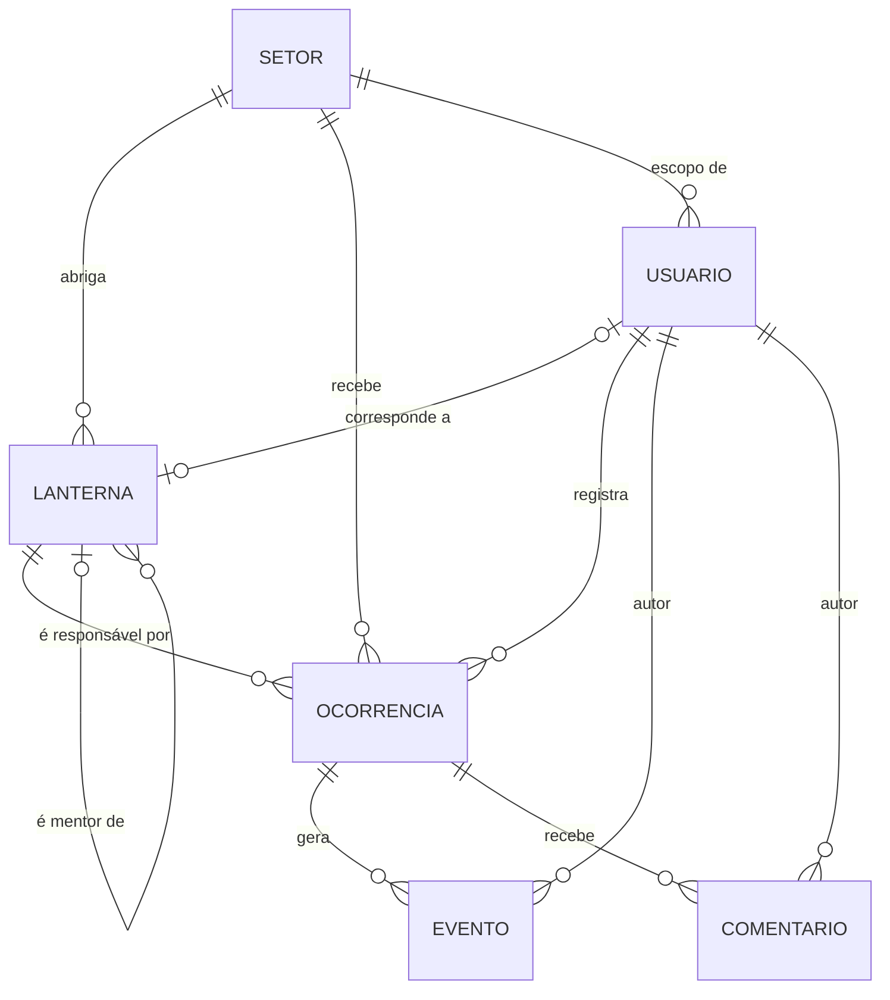

# Modelo de dados

Versão de 2026-11-06, decisões fechadas, derivada de [ESCOPO.md](ESCOPO.md) (D4, D7 a D24). Banco SQLite via TypeORM, esquema por migrations. Termos em [GLOSSARY.md](../../GLOSSARY.md).

## Diagrama

## Entidades

### Setor

| Coluna | Tipo | Regras |
|---|---|---|
| `id` | inteiro, chave primária | Igual ao número do Setor (0, 674, 1417, 2814...). (D22) |
| `nome` | texto | Obrigatório. |
| `descricao` | texto | Obrigatório. |

### Lanterna

| Coluna | Tipo | Regras |
|---|---|---|
| `id` | texto, chave primária | Slug estável (`hal-jordan`), usado na URL da Ficha. |
| `codinome` | texto | Obrigatório. |
| `identidadeCivil` | texto, nulo | |
| `especie`, `planetaNatal` | texto | Obrigatórios. |
| `setorId` | FK → Setor, nulo | Opcional (D25): Lanterna cuja pesquisa não verificou o Setor fica sem ele e não recebe Atribuição. |
| `status` | `ativo` \| `em_missao` \| `afastado` | Estado do sistema (D8), não dado de pesquisa. |
| `anoIngresso` | inteiro, nulo | |
| `primeiraAparicao` | texto, nulo | Título, número e mês/ano. |
| `habilidades` | lista de textos (JSON) | |
| `mentorId` | FK → Lanterna, nulo | Auto-relacionamento (D13). |
| `citacao` | texto, nulo | Só com fonte; até 15 palavras. |
| `biografia` | texto, nulo | |
| `fontes` | JSON | Por campo: URL e `verificado` ou `não verificado` (D14). |

Dados calculados na Ficha (D13), sem coluna: resolvidas, em andamento, tempo médio de resolução e carga atual.

### Usuario

| Coluna | Tipo | Regras |
|---|---|---|
| `id` | UUID | |
| `nome` | texto | Obrigatório. |
| `email` | texto, único | Minúsculas. |
| `senhaHash` | texto | bcrypt. Nunca sai em resposta, token ou log. |
| `papel` | `guardiao` \| `lanterna` | Nunca vem do corpo do cadastro (D3). |
| `setorId` | FK → Setor, nulo | Obrigatório para o Lanterna; nulo para o Guardião. Define o escopo (RN-05). |
| `lanternaId` | FK → Lanterna, nulo, único | Liga a conta à Ficha do Lanterna (Usuário 1—1 Lanterna, D4). Vazio após o cadastro; o Guardião vincula (RN-07). |
| `criadoEm` | data e hora | |

O escopo de um Lanterna logado é o `setorId` do **Usuário** (RN-05), escolhido no cadastro; a Ficha (`lanternaId`) é um vínculo à parte feito pelo Guardião (RN-07).

### Ocorrencia

| Coluna | Tipo | Regras |
|---|---|---|
| `id` | UUID | |
| `titulo` | texto | 5 a 100 caracteres. |
| `descricao` | texto | Mínimo 10 caracteres. |
| `planeta` | texto | Mínimo 2 caracteres. |
| `setorId` | FK → Setor | Obrigatório; o servidor fixa o do Lanterna (D3 e regras atuais). |
| `gravidade` | `baixa` \| `media` \| `alta` \| `critica` | |
| `status` | `aberta` \| `em_andamento` \| `resolvida` | Ver [REGRAS-DE-NEGOCIO.md](REGRAS-DE-NEGOCIO.md). |
| `envolvidos` | inteiro | Mínimo 1. |
| `responsavelId` | FK → Lanterna, nulo | Pertence ao mesmo Setor da Ocorrência. |
| `resolucao` | texto, nulo | Obrigatória ao resolver (mín. 10 caracteres). |
| `criadaPorId` | FK → Usuario | Vem do token. |
| `criadaEm` | data e hora | |
| `resolvidaEm` | data e hora, nulo | Base do tempo médio de resolução. |
| `excluidaEm` | data e hora, nulo | Soft delete (D4). Listas ignoram excluídas. |

`prazoEm` e `vencida` são **derivados** (D9): `criadaEm` mais a janela da Gravidade; vencida é "não resolvida e prazo passado". A API os devolve, não são colunas.

### Evento

Imutável (D16). Criado na mesma transação da mudança.

| Coluna | Tipo | Regras |
|---|---|---|
| `id` | UUID | |
| `ocorrenciaId` | FK → Ocorrencia | |
| `tipo` | `criada` \| `atribuida` \| `status_alterado` \| `reaberta` \| `resolvida` \| `comentario_apagado` | |
| `autorId` | FK → Usuario | |
| `dados` | JSON | O que mudou: `de` e `para`, motivo, responsável. |
| `criadoEm` | data e hora | |

### Comentario

| Coluna | Tipo | Regras |
|---|---|---|
| `id` | UUID | |
| `ocorrenciaId` | FK → Ocorrencia | |
| `autorId` | FK → Usuario | |
| `texto` | texto | 1 a 1000 caracteres. (D22) |
| `criadoEm` | data e hora | |
| `excluidoEm` | data e hora, nulo | Soft delete; sem edição (D16). |

## Integridade

- Chaves estrangeiras valem em SQLite apenas com `PRAGMA foreign_keys = ON`; a conexão deve ativá-lo.
- Apagar Setor ou Lanterna que tenha registros ligados é recusado (409); não há `ON DELETE CASCADE` nessas relações.
- `CHECK` no banco para os enums e para `envolvidos >= 1`, como última linha de defesa.
- Índices: `ocorrencia(setorId, status)`, `ocorrencia(responsavelId, status)`, `ocorrencia(criadaEm)`, `evento(ocorrenciaId, criadoEm)`, `comentario(ocorrenciaId, criadoEm)`.

## Seed

- **Setores:** pelo menos 8 (D12); os 5 do `db.json` mais os que a pesquisa trouxer.
- **Lanternas:** ~25, a partir de `docs/research/lanternas/` depois da auditoria (D15). Campos sem fonte ficam nulos.
- **Usuários:** um Guardião e os Lanternas de demonstração. As senhas do seed são hasheadas com bcrypt; as de demonstração vão no README, nunca em texto no banco.
- **Ocorrências:** as 9 atuais, com Eventos coerentes com o estado de cada uma.
