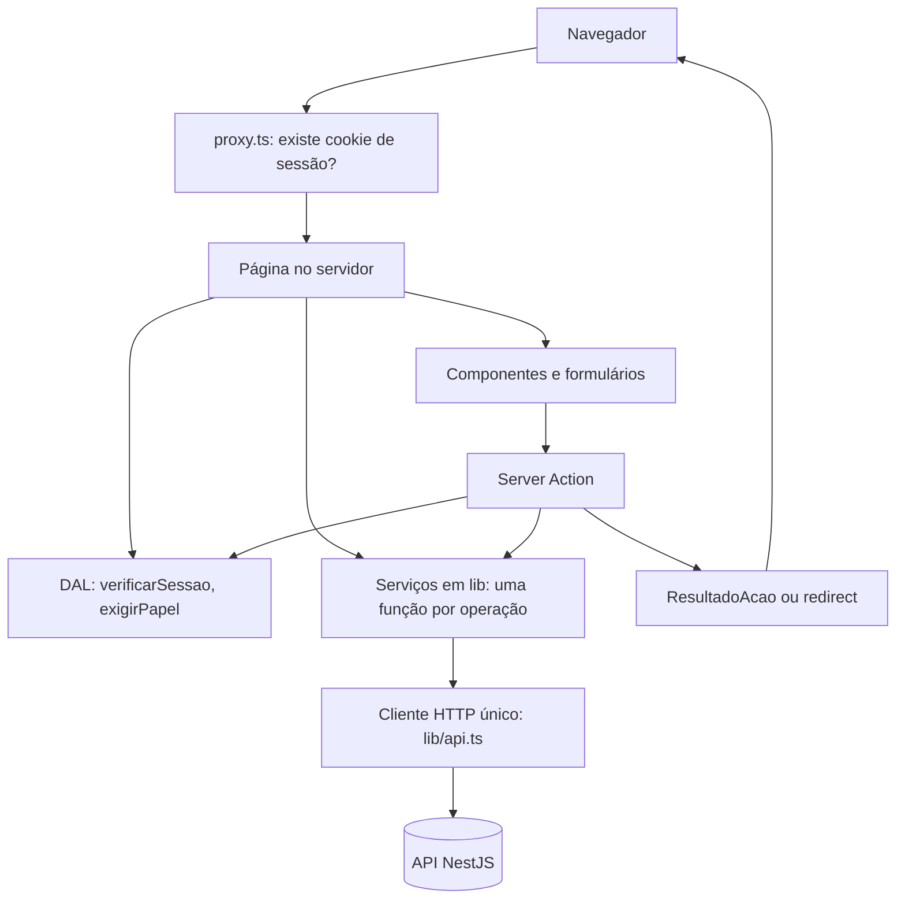

# Arquitetura do front-end

Documento de **destino**, de 2026-11-06. Onde o código de hoje difere, a seção diz o que muda e [MIGRACAO.md](MIGRACAO.md) lista os arquivos. As regras de código vêm da skill [`frontend-web`](../../.claude/skills/frontend-web/SKILL.md); os IDs abaixo (como API-17) são dela e devem ser consultados com `node .claude/skills/frontend-web/scripts/consultar.mjs <ID>`. O contrato da API está em [backend/API.md](../backend/API.md).

## Visão

Next.js (App Router) em TypeScript, Tailwind, shadcn/ui sobre Base UI, React Hook Form com Zod 4 e Vitest. O Next é a **camada servidora** entre o navegador e a API: o navegador nunca chama a API nem vê o token ([ADR 0001](../adr/0001-token-jwt-fica-no-servidor-do-next.md), AUTH-12).

## Camadas

| Camada | Onde | Responsabilidade | Regras |
|---|---|---|---|
| Cliente HTTP | `lib/api.ts` | Único lugar que faz `fetch`: monta a URL a partir de `API_URL`, anexa `Authorization: Bearer`, abre o envelope, lança `ApiError` | API-02, API-03, API-08, API-16, API-17 |
| Serviços | `lib/<recurso>.ts` | Uma função por operação; valida a resposta com Zod | API-01, API-04 |
| Schemas | `lib/schemas/` | Formato das respostas e dos formulários, os mesmos no cliente e na Action | FORM-17, API-04 |
| DAL | `lib/dal.ts` | `verificarSessao` (consulta a API), `exigirPapel`, leitura e remoção do cookie | AUTH-04, AUTH-06 |
| Actions | `app/**/actions.ts` | Recebem `unknown`, conferem sessão e papel, validam, chamam o serviço, revalidam e navegam | AUTH-05, FORM-17, FORM-18, API-14, ROTA-20 |
| Páginas | `app/**/page.tsx` | Server Components; buscam dados e aplicam o filtro de escopo | API-05, API-07, AUTH-07 |
| Componentes | `components/`, `_components/` | Props e estado local; `'use client'` só onde há interação | ROTA-08 |

Os serviços **não recebem sessão**: quem os chama aplica o escopo do papel antes (a API é a autoridade, DEC-03, AUTH-07). Reutilizar um serviço não aplica permissão sozinho.

## Sessão e permissões

1. `login` (Server Action) chama `POST /auth/login`, grava o JWT em cookie `httpOnly` (`secure` em produção, `sameSite: lax`), com validade alinhada à do token (AUTH-02, AUTH-08).
2. `proxy.ts` só confere se o cookie existe e redireciona ao `/login` (AUTH-01); não decide permissão.
3. Cada página privada chama `verificarSessao()`, que consulta `GET /auth/me` e devolve `usuario`, `papel` e `setorId` (AUTH-04). O papel e o setor exibidos vêm da API, nunca de dados que o front produziu.
4. Cada Action confere sessão e papel **antes** de validar (AUTH-05).
5. Papel insuficiente: `exigirPapel` leva a `/acesso-negado` (AUTH-06). Recurso de outro Setor: a API responde **404** e a tela mostra "não encontrado" (muda em relação ao comportamento de hoje).
6. 401 da API significa token recusado: encerra a sessão pelo Route Handler e volta ao login (AUTH-13).
7. Sair apaga o cookie por Server Action (AUTH-09). Mutação só por Server Action, nunca por GET (AUTH-14).

Não há `?next=`: depois do login o usuário vai a `/painel` com `replace` (ROTA-19).

## Dados, cache e estados

- Leitura em Server Components com `fetch` direto; **sem** TanStack Query, SWR, Context ou estado global (DEC-01, DEC-02, DEC-07, API-15).
- Cache explícito em todo `fetch` (API-06). Dados privados e de escrita frequente (ocorrências, eventos, comentários, dashboard) vão sem cache; Setores e Lanternas podem usar revalidação curta.
- Buscas independentes em `Promise.all` (API-07). Ficha e Detalhe fazem várias (dados, eventos, comentários).
- Toda tela com dados trata **quatro estados**: carregando, erro, vazio e com dados (API-09), com `loading.tsx` e `error.tsx` (API-10, API-11, ROTA-21).
- Cada status da API tem destino no front (API-12): 400 vira erro de campo, 401 login, 403 `/acesso-negado`, 404 `not-found`, 409 e 422 mensagem da regra, 429 aviso de espera, 500 `error.tsx` com "Tentar de novo".
- O `codigo` estável do erro (ex.: `LANTERNA_AFASTADO`) vira erro de campo ou erro geral, nunca é decidido pelo texto da `mensagem` (API-18).
- Listas vêm paginadas (`dados.itens` e `dados.meta`); página, filtros e ordenação vivem na **URL** (`searchParams`), não em `useState` (ROTA-14, API-19, PROD-06).

## Formulários

React Hook Form chama a Server Action com os dados; a Action recebe `unknown` e revalida com o **mesmo** schema Zod (DEC-05, FORM-17). `ResultadoAcao` (`ok`, `erro` geral, `errors` por campo) volta ao formulário e `aplicarErrosDoServidor` o aplica nos campos. Mutação que cria ou atribui redireciona; mudança de status devolve `{ ok: true }` (API-14).

Telas novas que seguem esse padrão: cadastro, registrar ocorrência, mudar status (com resolução ou motivo), atribuir, comentar, criar e editar Setor e Lanterna, promover papel.

## Interface

- Base visual oficial: OANET em `components/oanet/` e [UI.md](../UI.md), conforme D28. Componentes Base UI permanecem como fundamento semântico; as rotas reais recebem a apresentação do laboratório por extração/composição, preservando Server Components, serviços, Actions e permissões.
- Tema único escuro por tokens em `app/globals.css` (DEC-13, PROD-10). Fontes: Barlow, Barlow Condensed e IBM Plex Mono.
- `/laboratorio` é a referência oficial de componentes, assets e movimento; continua demonstrativo e sem API. `/design-system` antigo é histórico e deve ser atualizado ou redirecionado na adoção. Novas telas, inclusive as de gestão ainda sem protótipo, usam a linguagem de [UI.md](../UI.md).
- Acessibilidade verificável, não declarada: foco visível, estados com rótulo além da cor, movimento reduzido (PROD-08). Dashboard e gráficos têm equivalente textual.

## Produção

Itens da seção `PROD` que se aplicam e ainda não existem no app:

| ID | Item | Estado |
|---|---|---|
| PROD-01 | Variáveis de ambiente validadas na subida | A fazer |
| PROD-02, PROD-03 | Cabeçalhos de segurança e CSP | A fazer |
| PROD-04 | Metadata, robots e sitemap | A fazer |
| PROD-05 | Monitoramento de erros (Sentry opcional) | A fazer |
| PROD-09 | Core Web Vitals medidos | A fazer |
| PROD-11 | E2E com Playwright sobre o build e a API real | A fazer |

## Testes

Vitest com React Testing Library para schemas, serviços, helpers, Actions (com dependências simuladas) e componentes. Server Components assíncronos não são cobertos por unitário; a integração com a API real é verificada no E2E (PROD-11). Os testes de serviço passam a simular `fetch` com o **envelope** da API, não mais com os dados do `db.json`.
